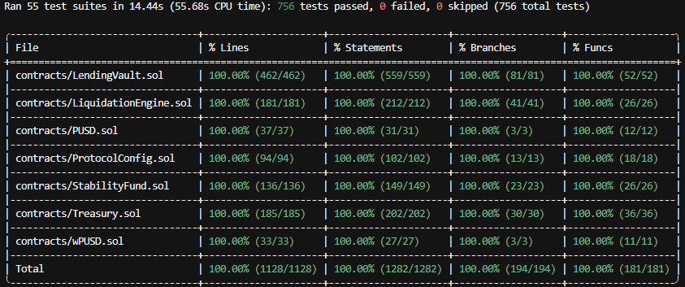

# Lending Protocol

A decentralized lending protocol that allows users to deposit collateral
and borrow a protocol-issued stablecoin, PUSD.

The system combines collateralized lending with a stability fund, a
liquidation engine and a treasury. These components manage user positions,
provide liquidity for liquidations and support the protocol's risk management.

## Origin and License

This repository is a cleaned-up and rebranded copy of a DeFi lending
protocol I worked on as part of a five-engineer team. The original contracts
were deployed and verified on Ethereum mainnet under a different name.

The source carries an MIT `SPDX-License-Identifier` in every file and is
republished under those terms. See [LICENSE](LICENSE) for the copyright notice.

The main proxy addresses from the original deployment are listed in the
[Deployments](#-deployments) section for reference. Internal tooling,
CI configuration and operational artifacts have been removed from this
repository.

Protocol-owned addresses in `script/NetworkAddresses.sol` are set to
`address(0)` and must be configured before running scripts that depend on
them. Third-party infrastructure addresses are retained as public references.

## ⚙️ How It Works

1. **Deposit collateral:** Users deposit supported collateral into the
   LendingVault to open or increase a position.

2. **Borrow PUSD:** Users borrow the protocol's stablecoin against their
   collateral, subject to collateralization requirements.

3. **Repay and withdraw:** Users can repay their debt and withdraw collateral,
   provided their position remains within the required limits.

4. **Provide stability liquidity:** Users can deposit PUSD into the
   StabilityFund and receive wPUSD, which represents their participation
   in the fund.

5. **Manage liquidations:** When a position becomes eligible for liquidation,
   the protocol's liquidation mechanism handles the position and sources
   liquidity through the available protocol mechanisms.

### Protocol-Operated Liquidations

Liquidations are handled by the protocol rather than relying on individual
users to liquidate positions directly.

The liquidation flow accounts for the liquidity available to the protocol
and coordinates the relevant components, including the StabilityFund and
Treasury. It also manages protocol states associated with liquidations and
subsequent stabilization.

## 🏗️ Architecture

The protocol is composed of interconnected contracts with distinct
responsibilities:

| Contract | Responsibility |
| --- | --- |
| [PUSD](contracts/PUSD.sol) | Protocol-issued stablecoin with restricted minting and burning. |
| [wPUSD](contracts/wPUSD.sol) | Wrapped token representing participation in the StabilityFund. |
| [ProtocolConfig](contracts/ProtocolConfig.sol) | Manages protocol parameters and permissions. |
| [LendingVault](contracts/LendingVault.sol) | Manages collateral deposits, borrowing, repayments and withdrawals. |
| [StabilityFund](contracts/StabilityFund.sol) | Accepts PUSD deposits, issues wPUSD and provides liquidity for protocol operations. |
| [LiquidationEngine](contracts/LiquidationEngine.sol) | Coordinates the liquidation of eligible positions. |
| [Treasury](contracts/Treasury.sol) | Manages protocol funds and participates in backstop mechanisms. |
| [DataTypes](contracts/DataTypes.sol) | Contains data types used across the protocol. |

Contract interfaces are available in
[`contracts/interfaces/`](contracts/interfaces/) and mock contracts are
available in [`contracts/mocks/`](contracts/mocks/).

## 🚀 Features

### Lending

- Deposit supported collateral and borrow PUSD.
- Repay debt and withdraw collateral, subject to protocol requirements.
- Manage positions using configurable collateralization parameters.

### Stability and Liquidations

- Deposit PUSD into the StabilityFund and receive wPUSD.
- Handle eligible liquidations through the protocol's liquidation mechanism.
- Coordinate available liquidity and protocol states during liquidations.
- Use the Treasury as part of the protocol's backstop mechanisms.

### Administration and Security

- Role-based access control.
- UUPS upgradeability for supported contracts.
- Pausable operations.
- Configurable protocol parameters.

## 🌐 Deployments

The following addresses are the main proxy contracts from the original
protocol deployment on **Ethereum mainnet**.

The original protocol was deployed under a different name. This repository
is a cleaned-up and rebranded reference copy; its contents should not be
assumed to match the current deployed implementations exactly.

| Contract | Ethereum Mainnet Proxy |
| --- | --- |
| LendingVault | [0x29d0...372a](https://etherscan.io/address/0x29d0cb5155e4d395f52d4fe320c37343bc64372a#code) |
| StabilityFund | [0x8329...783d](https://etherscan.io/address/0x83295d733d3c8b3700b90b77bdc76826b9c7783d#code) |
| Treasury | [0xe018...0674](https://etherscan.io/address/0xe0180c026f8f47292f2c0cc5cdcb58236b860674#code) |
| LiquidationEngine | [0x2778...0348](https://etherscan.io/address/0x2778b5f2aed8de1b2b87d372228a251662790348#code) |

## 🛠️ Tech Stack

- **Smart contracts:** Solidity and OpenZeppelin.
- **Development and testing:** Foundry.
- **External infrastructure:** Chainlink, Uniswap V3 and wstETH.
- **Upgradeability:** UUPS proxies for supported contracts.

## 🧪 Testing

The contracts are tested with Foundry. The test suite includes unit and
invariant tests, with fuzz, fork and integration tests where applicable.

Explore the [full test suite](test/) or browse the
[smart contract source](contracts/).

### Tests by Component

- [LendingVault](test/LendingVault/)
  - [Borrow](test/LendingVault/Borrow.t.sol)
  - [Deposit](test/LendingVault/Deposit.t.sol)
  - [Repay](test/LendingVault/Repay.t.sol)
  - [Withdraw](test/LendingVault/Withdraw.t.sol)
  - [Liquidate Position](test/LendingVault/LiquidatePosition.t.sol)
  - [Oracle](test/LendingVault/Oracle.t.sol)
  - [Invariants](test/LendingVault/Invariants/)
- [LiquidationEngine](test/LiquidationEngine/)
- [ProtocolConfig](test/ProtocolConfig/)
- [PUSD](test/PUSD/)
- [StabilityFund](test/StabilityFund/)
- [Treasury](test/Treasury/)
- [wPUSD](test/wPUSD/)

### Run All Tests

```bash
forge test
```

### Run Tests with Gas Reporting

```bash
forge test --gas-report
```

### Run Specific Tests

```bash
forge test --match-contract LendingVaultTest
forge test --match-test testDeposit
```

### Generate a Coverage Report

```bash
forge coverage
```

To generate an LCOV report:

```bash
forge coverage --report lcov --out lcov.info
```

If you encounter a `stack too deep` error during coverage, try:

```bash
forge coverage --ir-minimum --report lcov --out lcov.info
```

### Coverage Results

The coverage report shown below includes **756 passing tests** and **100%
coverage** across lines, statements, branches and functions for the measured
contracts in `contracts/`.



## 🔧 Getting Started

### Prerequisites

- [Foundry](https://book.getfoundry.sh/getting-started/installation)
- Git

### Setup

1. **Clone the repository**

   ```bash
   git clone https://github.com/purriza/lending-protocol.git
   cd lending-protocol
   ```

2. **Install dependencies**

   ```bash
   forge install
   ```

3. **Set up environment variables**

   ```bash
   cp .env.example .env
   ```

   Edit `.env` with the values needed for your environment.

4. **Build the contracts**

   ```bash
   forge build
   ```

5. **Run the tests**

   ```bash
   forge test
   ```

## 📋 Environment Variables

The project uses the following environment variables for deployment,
verification and network access:

```bash
# Deployment and verification
DEPLOYER_PRIVATE_KEY=your_private_key_here
ETHERSCAN_API_KEY=your_etherscan_api_key_here

# RPC URLs
SEPOLIA_RPC_URL=https://eth-sepolia.g.alchemy.com/v2/your_api_key
MAINNET_RPC_URL=https://eth-mainnet.g.alchemy.com/v2/your_api_key
```

- **`DEPLOYER_PRIVATE_KEY`:** Private key used for deployment and upgrades.
- **`ETHERSCAN_API_KEY`:** API key used for contract verification.
- **`SEPOLIA_RPC_URL`:** RPC endpoint for Ethereum Sepolia.
- **`MAINNET_RPC_URL`:** RPC endpoint for Ethereum mainnet.

The variables needed depend on the command and network being used.

## 📦 Deployment and Configuration

This repository includes scripts for deploying, configuring, upgrading
and verifying contracts.

### Address Configuration

Scripts use `script/NetworkAddresses.sol` to resolve addresses for the
configured network. Protocol-owned addresses in this public repository are
set to `address(0)` and must be populated before running scripts that depend
on them.

Check the network configuration and deployment flags before using any
deployment, configuration or upgrade script.

### Local Deployment

Start a local Anvil node:

```bash
anvil
```

Then run the deployment script:

```bash
./scripts/deploy/deploy-contracts.sh local
```

### Testnet Deployment

Configure the required deployment flags in `script/deploy/Deploy.s.sol`,
then deploy to Sepolia:

```bash
./scripts/deploy/deploy-contracts.sh sepolia
```

### Mainnet Deployment

Configure the required deployment flags and network addresses before running
the mainnet deployment script:

```bash
./scripts/deploy/deploy-contracts.sh mainnet
```

### Configure Contracts

After deployment, configure contract relationships and parameters:

```bash
# Configure contracts on Sepolia
./scripts/deploy/configure-contracts.sh sepolia

# Configure contracts on mainnet
./scripts/deploy/configure-contracts.sh mainnet
```

Individual Foundry configuration scripts are available in `script/config/`.

### Verify Contracts

```bash
./scripts/verification/verify-contracts.sh sepolia
```

### Deployment Scripts

- **[`scripts/deploy/deploy-contracts.sh`](scripts/deploy/deploy-contracts.sh):** Deploy contracts.
- **[`scripts/deploy/configure-contracts.sh`](scripts/deploy/configure-contracts.sh):** Configure contract
  relationships and parameters.
- **[`scripts/deploy/upgrade-contracts.sh`](scripts/deploy/upgrade-contracts.sh):** Upgrade supported contracts.

## 🔄 Upgrades

Supported contracts use the UUPS proxy pattern.

To prepare an upgrade:

1. Configure the relevant upgrade flags in `script/deploy/Upgrade.s.sol`.
2. Populate and verify the proxy addresses used by the scripts.
3. Test the upgrade and validate storage compatibility.
4. Run the upgrade script for the intended network.

Example:

```bash
./scripts/deploy/upgrade-contracts.sh sepolia
```

Upgrade permissions and production execution should be reviewed carefully
before any transaction is submitted.

## 🔒 Security

Security considerations include:

- Role-based access control and upgrade permissions.
- Collateralization requirements and liquidation behavior.
- Pausable operations and reentrancy protection.
- Validation of protocol parameters and contract interactions.

The original contracts underwent an external audit before their mainnet
deployment, and audit findings were addressed during development.

This repository is published as a reference and portfolio project. Its
presence here does not imply that the current contents have independently
undergone the same audit or that they are ready for a new deployment.

Any new deployment should be independently reviewed, tested and audited.

## 📁 Repository Structure

- [`contracts/`](contracts/): Smart contract source code.
- [`contracts/interfaces/`](contracts/interfaces/): Contract interfaces.
- [`contracts/mocks/`](contracts/mocks/): Mock contracts.
- [`test/`](test/): Test suites grouped by component.
- [`script/`](script/): Foundry deployment, upgrade and configuration scripts.
- [`scripts/`](scripts/): Bash automation scripts.
- [`tools/`](tools/): Supporting tooling.
- [`LICENSE`](LICENSE): License and copyright notice.

## 📚 Resources

- [Foundry Book](https://book.getfoundry.sh/)
- [OpenZeppelin Documentation](https://docs.openzeppelin.com/)
- [Solidity Documentation](https://docs.soliditylang.org/)

## ⚠️ Disclaimer

This repository is provided for reference and portfolio purposes.
It is not presented as deployment-ready software.

Any new deployment should be independently reviewed, tested and audited.
DeFi protocols involve smart contract and financial risks.